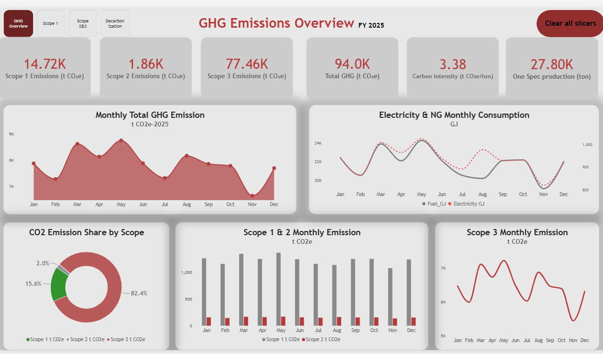
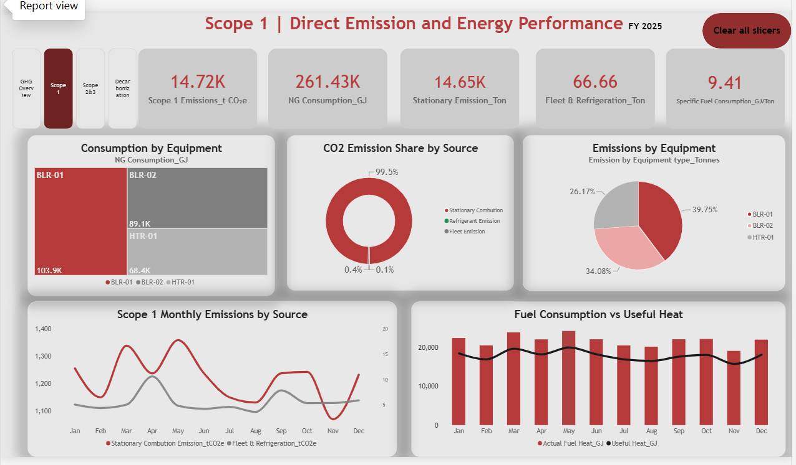
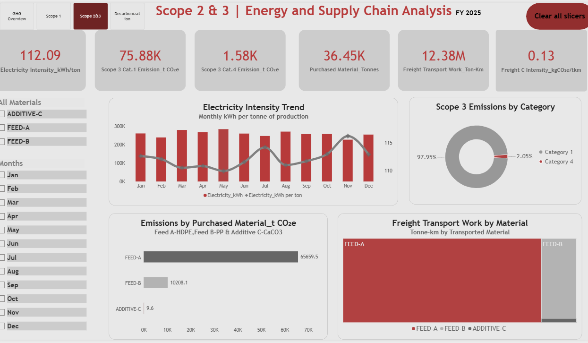
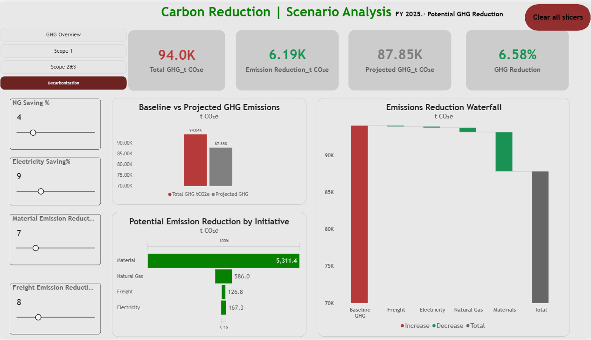

# GHG-EMISSION-ANALYSIS-DASHBOARD
Power BI portfolio project demonstrating Scope 1, 2 &amp; 3 GHG accounting, industrial energy performance, supply-chain emissions, and interactive decarbonization scenarios using synthetic manufacturing data and published emission factors.

  

  

  

  

